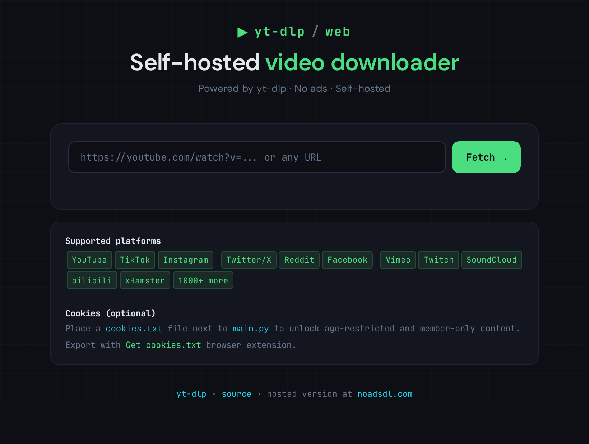
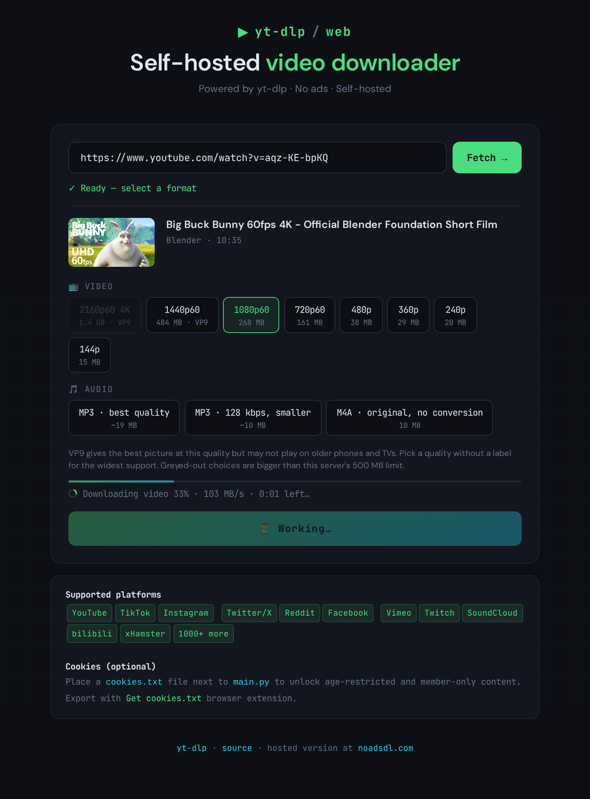

# yt-dlp/web

[](https://github.com/samrtulethtb/yt-dlp-web/actions/workflows/ci.yml)

A clean, self-hosted web frontend for [yt-dlp](https://github.com/yt-dlp/yt-dlp).
Download videos and audio from YouTube, TikTok, Instagram, Twitter, Reddit, and 1000+ platforms — on your own computer, with no ads and no limits.

> **Don't want to self-host?** Use the free hosted version at **[noadsdl.com](https://noadsdl.com)** — zero ads, zero signup, same yt-dlp engine.




---

## Features

- 🎬 **Video** — MP4 up to 4K, one clear choice per quality, picked to play on every device
- 🎵 **Audio** — MP3 (best quality or smaller 128 kbps) or the original M4A without conversion
- 📊 **Real progress** — percent, speed and time left while the server downloads
- 📱 **Phone friendly** — files are saved by the browser itself, so big files work on phones too
- 🔄 **Stays working** — updates yt-dlp by itself once a day, because sites change often
- 🍪 **Cookie support** — age-restricted & member-only content
- 🔒 **Private by default** — only your computer can open it until you choose otherwise
- 🌍 **Ready to share** — optional password, or a public mode with limits per visitor
- 🖥 **Cross-platform** — Windows, macOS, Linux
- ⚡ **Minimal** — single file backend, zero database
- 🐳 **Docker** — one command, everything included

---

## Quick Start

### Option A: Docker (easiest)

You need [Docker Desktop](https://www.docker.com/products/docker-desktop/) (Windows, macOS) or Docker Engine (Linux). Everything else (ffmpeg, Deno, yt-dlp) is inside the image.

```bash
git clone https://github.com/samrtulethtb/yt-dlp-web
cd yt-dlp-web
docker compose up -d
```

Open **http://localhost:8080** in your browser.

### Option B: Python

You need three things installed first:

- **Python 3.11 or newer** — [python.org](https://www.python.org/downloads/)
- **ffmpeg** — merges video with audio and makes MP3 files
- **Deno** — YouTube needs a JavaScript runtime. If you already have **Node.js 20 or newer**, you can skip Deno.

| System | ffmpeg | Deno |
|---|---|---|
| Windows | `winget install Gyan.FFmpeg` | `winget install DenoLand.Deno` |
| macOS | `brew install ffmpeg` | `brew install deno` |
| Linux (Debian/Ubuntu) | `sudo apt install ffmpeg` | `curl -fsSL https://deno.land/install.sh \| sh` |

Close and reopen your terminal after installing, so it finds the new programs.

**Linux / macOS:**

```bash
git clone https://github.com/samrtulethtb/yt-dlp-web
cd yt-dlp-web
python3 -m venv venv
source venv/bin/activate
pip install -r requirements.txt
python3 main.py
```

**Windows:**

```bat
git clone https://github.com/samrtulethtb/yt-dlp-web
cd yt-dlp-web
python -m venv venv
venv\Scripts\activate
pip install -r requirements.txt
python main.py
```

Open **http://localhost:8080** in your browser.

---

## Updating

- **yt-dlp updates itself** every 24 hours while the app runs. Turn this off with `YTDLP_AUTO_UPDATE=false`.
- **The app itself:** run `git pull`, then restart it. With Docker: `git pull && docker compose up -d --build`.

---

## Cookie Support (optional)

Needed for: age-restricted videos, member-only content, private playlists.

1. Install the **[Get cookies.txt LOCALLY](https://chrome.google.com/webstore/detail/get-cookiestxt-locally/cclelndahbckbenkjhflpdbgdldlbecc)** browser extension
2. Log in to YouTube (or any platform)
3. Click the extension → Export cookies
4. Save the file as `cookies.txt` next to `main.py`
5. **Docker only:** uncomment the two `volumes` lines in `docker-compose.yml`
6. Restart the app

> Cookies are your logged-in session. Never share `cookies.txt`, and use a spare account if you can.

> **TikTok note**: Works on home connections. Server/VPS IPs may be blocked by TikTok — add `cookies.txt` to fix.

---

## Using it from other devices

By default only the computer running the app can open it. To use it from your phone or another computer on your home network:

- **Python:** start it with `HOST=0.0.0.0 python3 main.py` (Windows: `set HOST=0.0.0.0` then `python main.py`), then open `http://<your-computer's-IP>:8080`.
- **Docker:** in `docker-compose.yml`, change `"127.0.0.1:8080:8080"` to `"8080:8080"`, then run `docker compose up -d`.

---

## Putting it on the internet

Anyone who can open the app can download through your server and use up your bandwidth, so pick one of these first.

**Just for you, family or friends: set a password.**

```bash
ACCESS_PASSWORD='pick-a-long-password' python3 main.py
```

The browser asks for it once (any user name works). With Docker, add `- ACCESS_PASSWORD=pick-a-long-password` under `environment` in `docker-compose.yml`. After 10 wrong tries, a visitor has to wait 15 minutes.

**Open to everyone: turn on public mode.**

```bash
PUBLIC_MODE=true python3 main.py
```

Public mode gives every visitor (IP address):

- `DOWNLOADS_PER_DAY` downloads a day (20 by default; failed downloads don't count)
- at most 2 downloads at once, and 30 link lookups per 10 minutes
- no access for scripts and bots (curl, Python, headless browsers…); it works from web browsers only

The limits live in memory and start again when the app restarts. You are responsible for how a public server is used, so keep an eye on it.

**Use HTTPS in both cases**, so the password and the links stay private. The easiest way is [Caddy](https://caddyserver.com/docs/install), which gets a certificate by itself. Point your domain at the server, keep the app on `HOST=127.0.0.1`, and put this in `/etc/caddy/Caddyfile`:

```
yourdomain.com {
    reverse_proxy 127.0.0.1:8080
}
```

Then run `sudo systemctl reload caddy`. (No proxy? Start the app with `HOST=0.0.0.0` instead, but then the password travels unencrypted.)

<details>
<summary>Using nginx instead</summary>

```nginx
server {
    listen 80;
    server_name yourdomain.com;

    location / {
        proxy_pass http://127.0.0.1:8080;
        proxy_read_timeout 300s;
        proxy_set_header Host $host;
        proxy_set_header X-Forwarded-For $proxy_add_x_forwarded_for;
        proxy_set_header X-Forwarded-Proto $scheme;
    }
}
```

Add HTTPS with [Certbot](https://certbot.eff.org/): `sudo certbot --nginx -d yourdomain.com`.
</details>

**Docker behind Caddy or nginx:** the app sees the proxy, not the visitor, so every visitor would share one set of limits. Add `- FORWARDED_ALLOW_IPS=*` under `environment`, and keep the port line as `"127.0.0.1:8080:8080"` so only the proxy can reach the app.

---

## Configuration

Set these as environment variables before starting the app (Docker: under `environment` in `docker-compose.yml`).

| Variable             | Default       | Description |
|----------------------|---------------|-------------|
| `HOST`               | `127.0.0.1`   | Who can connect. `0.0.0.0` = every device that can reach this computer |
| `PORT`               | `8080`        | HTTP port |
| `MAX_SIZE_MB`        | `500`         | Largest file the app will download, in MB. Bigger choices are greyed out |
| `MAX_PARALLEL_DOWNLOADS` | `2`       | Downloads that run at the same time; others wait their turn |
| `DOWNLOAD_TIMEOUT_MINUTES` | `60`    | A download that takes longer is stopped |
| `COOKIES_FILE`       | `cookies.txt` | Path to the cookies file |
| `YTDLP_AUTO_UPDATE`  | `true`        | Update yt-dlp at start and every 24 hours |
| `ACCESS_PASSWORD`    | (none)        | Ask for this password before anything else |
| `PUBLIC_MODE`        | `false`       | Limits per visitor and no scripts, for a server open to everyone |
| `DOWNLOADS_PER_DAY`  | `20`          | Downloads per visitor per day in public mode (`0` = no daily limit) |
| `FORWARDED_ALLOW_IPS`| `127.0.0.1`   | Proxies trusted to pass on the visitor's IP. `*` for Docker behind a proxy |
| `ALLOW_PRIVATE_URLS` | `false`       | Allow links to local network addresses (`192.168.x.x`, `localhost`…). Leave off on a public server |

**Example:**
```bash
PORT=9000 MAX_SIZE_MB=1000 python3 main.py
```

Finished files are kept on the server for 30 minutes, so the download can be retried, then deleted.

---

## Troubleshooting

- **YouTube shows only a few qualities, or none.** YouTube needs Deno (or Node.js 20+). Open `http://localhost:8080/api/health`: `js_runtime` should say `deno` or `node`. Install Deno (see Quick Start) and restart the app.
- **"Sign in to confirm you're not a bot".** YouTube is blocking your IP address for a while. Add `cookies.txt` (see above) or try again later.
- **MP3 or high qualities fail with an ffmpeg error.** ffmpeg is missing or your terminal doesn't see it yet. Install it and reopen the terminal.
- **A quality is greyed out.** It is bigger than `MAX_SIZE_MB` (500 MB by default). Raise the limit or pick a lower quality.
- **A quality says VP9 or AV1.** At that quality the site only offers newer video formats. They look great but may not play on older phones and TVs; qualities without a label use H.264, which plays everywhere.
- **A site stopped working.** Wait for the daily yt-dlp update or restart the app to update now. If it still fails, the site may not be supported by yt-dlp yet.

---

## Stack

- **Backend**: [FastAPI](https://fastapi.tiangolo.com/) + [yt-dlp](https://github.com/yt-dlp/yt-dlp)
- **Frontend**: Vanilla HTML/CSS/JS — no framework, no build step
- **Engine**: yt-dlp supports 1000+ sites out of the box

## Development

```bash
pip install -r requirements-dev.txt
python -m pytest
```

`tests/e2e_docker.py` checks a running app end to end (CI runs it against the Docker image):

```bash
python3 tests/e2e_docker.py http://127.0.0.1:8080 https://www.w3schools.com/html/mov_bbb.mp4
```

---

## Support
If this saved you time, consider giving it a ⭐ — it helps others find the project.

## License

[MIT](LICENSE) — do whatever you want with it.
